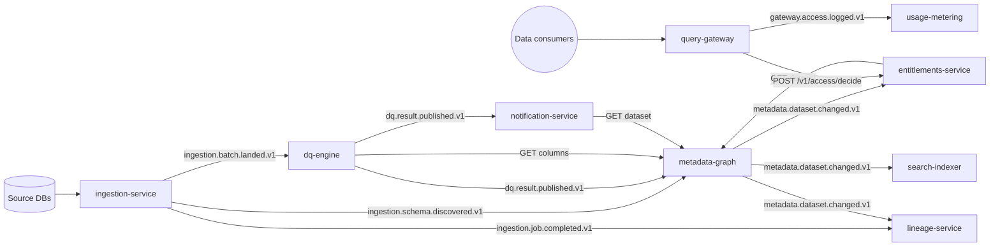

# Data platform overview (synthetic)

- REST calls between services go through `platform-sdk` typed clients.
- Event schemas and OpenAPI specs live in `platform-contracts`; `platform-sdk`
  pins a contracts release and validates payloads on publish.
- `platform-e2e` holds cross-service tests run in the `int` environment.
- `reporting-service` was decommissioned in 2025 and its repository archived;
  some older READMEs still mention it.
